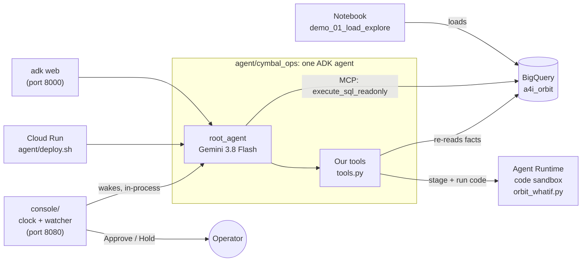

# The kickoff demo: a tour of the code

This is for anyone who wants to see how the finished solution fits together: a team deciding what to borrow, or
an instructor taking a few minutes in the code. The first part maps every file in the repo. The second follows
the demo through its three layers: the data, one question to the agent, and the console's week. Each step names
the function that does the work. The last part lists the places worth pointing at on screen.

For the challenge itself, see [README.md](README.md). For running it, see [agent/README.md](agent/README.md) and
[console/README.md](console/README.md). This page is only about the code.

## The idea in one paragraph

A notebook loads the public orbital catalog into five **BigQuery** tables and screens Cymbal Orbital's twelve
(fictional) satellites against it. **One ADK agent** on Gemini 3.8 Flash answers an operator's questions about
those approaches. It reads the tables through **BigQuery's Google-managed MCP server**, makes its judgments with
**four tools we wrote**, and runs its orbital what-ifs as Python in an **Agent Runtime code sandbox**, not in its
own process. The **console** is the Show step. A clock runs over the pinned week, plain code watches for what
matters and wakes the same agent to decide, and a human presses Approve or Hold.



## Part 1: what's in the repo

### Load & Explore: `notebooks/` and `data/`

| File | What it does |
|---|---|
| [`notebooks/demo_01_load_explore.ipynb`](notebooks/demo_01_load_explore.ipynb) | Run this first. It loads the catalog from Cloud Storage, gets the obvious answer wrong first (section 3), works through the real messes in the data (section 5), writes the five `a4i_orbit` tables (section 6), defines the Cymbal Orbital fleet (section 8), screens it against the sky (section 9) and frames the agent (section 12). |
| [`notebooks/demo_90_stage_catalog.ipynb`](notebooks/demo_90_stage_catalog.ipynb) | Maintainers only: pulls a fresh snapshot from Space-Track and stages it in Cloud Storage. |
| [`data/README.md`](data/README.md) | Why no orbital data is committed, and where it lives instead. |

### The agent: `agent/`

| File | What it does |
|---|---|
| [`cymbal_ops/agent.py`](agent/cymbal_ops/agent.py) | Builds `root_agent`, the one agent that `adk web`, Cloud Run and the console all run. It sets up the model (`DemoGemini`), the BigQuery MCP toolset (`bigquery_mcp`, read-only on purpose), our tools (`TOOLS`) and the sandbox. `DemoGemini` is ADK's `Gemini` class with time limits, retries with exponential backoff, and a fix for empty replies; its docstring explains each. |
| [`cymbal_ops/prompt.py`](agent/cymbal_ops/prompt.py) | The agent's instructions, including the honesty rules. `instruction()` is called each turn and fills in "now" and any fresh tracking from the session, so the console can run a clock. |
| [`cymbal_ops/tools.py`](agent/cymbal_ops/tools.py) | The four tools we wrote: `assess_conjunction()` (every fact about one approach, the judgments that need no model, and the case file staged in the sandbox), `run_in_sandbox()` (runs the model's Python in the sandbox), `maneuver_cost()` (delta-v into days of mission life) and `build_assessment()` (the final report, its facts re-read from BigQuery). |
| [`cymbal_ops/sandbox.py`](agent/cymbal_ops/sandbox.py) | Talks to the Agent Runtime code sandbox. `stage()` uploads the physics (`orbit_whatif.py` and a zip of sgp4, since the sandbox has no network) plus any case files; `run()` executes code and returns what it printed. |
| [`cymbal_ops/sandbox_files/orbit_whatif.py`](agent/cymbal_ops/sandbox_files/orbit_whatif.py) | The physics that runs **inside** the sandbox. Plain functions, so the model's code stays three lines long: `load_case()`, `baseline()`, `whatif()`, `smallest_burn()`. The docstring explains how a burn is modelled. |
| [`cymbal_ops/config.py`](agent/cymbal_ops/config.py) | Every setting, with its reason. Values come from `demo.env`; `generate_config()` holds the thinking level and service tier. |
| [`cymbal_ops/timing.py`](agent/cymbal_ops/timing.py) | Callbacks that log one `[timing]` line per step, so you can see where a turn's time went. |
| `cymbal_ops/requirements.txt`, `__init__.py` | What Cloud Run installs; the package marker ADK loads `root_agent` from. |
| [`setup_sandbox.py`](agent/setup_sandbox.py) | Creates (or reuses) the Agent Runtime instance and its sandbox, warms it up, and writes its name to `cymbal_ops/.env`. Run before rehearsing, because the first sandbox can take minutes to create. |
| [`smoke_test.py`](agent/smoke_test.py) | Asks the agent operator questions headless and checks that every part was used: MCP, our tools, the sandbox, an assessment. |
| [`model_check.py`](agent/model_check.py) | Times the candidate Gemini models right now, at the size of a real agent step, and says which to use. |
| [`deploy.sh`](agent/deploy.sh) | Deploys the agent to Cloud Run with `adk deploy cloud_run`, its own service account, and authentication required. |

### The console: `console/`

| File | What it does |
|---|---|
| [`app.py`](console/app.py) | The FastAPI service: the page, the controls (`/api/control`), Approve or Hold (`/api/decide`), the chat box (`/api/chat`) and the screen's state (`/api/state`). `ticker()` moves the clock; `handle_wake()` runs the agent when the watcher asks. |
| [`sim.py`](console/sim.py) | The clock and the watcher, all plain code, no model and deterministic. `Sim.advance()` moves time and fires triggers; `_wake()` pauses the clock and asks for the agent; `agent_result()` posts its card; `decide()` handles Approve or Hold and schedules a burn. |
| [`agent_bridge.py`](console/agent_bridge.py) | The console's line to the agent. `LiveAgent` runs the same `root_agent` in-process with ADK's `InMemoryRunner`, setting the session's clock and fresh tracking before every turn, and records each alert turn. `ReplayAgent` plays a recording back on the same rhythm. |
| [`orbits.py`](console/orbits.py) | SGP4 helpers for the pictures: positions, closest approach, the encounter plane, worst-case probability. |
| [`physics.py`](console/physics.py) | Runs the sandbox's own `orbit_whatif` here, to re-check an approved burn and draw the geometry after it. |
| [`data.py`](console/data.py) | Reads the console's slice of the snapshot from BigQuery once, into `.snapshot_extract.json` (git-ignored). |
| [`make_scenario.py`](console/make_scenario.py) → [`scenario.json`](console/scenario.json) | The week's storyline and its **one simulated input**: Tuesday's fresh tracking for moment B. The docstring shows how it is made. |
| [`elements.py`](console/elements.py) | Moves an element set to a new epoch along its own track; used by `make_scenario.py`. |
| [`keep_recording.py`](console/keep_recording.py) | Turns a good live run into `recordings/rehearsal.json`, after checking it tells the story and scrubbing project IDs. |
| [`recordings/rehearsal.json`](console/recordings/rehearsal.json) | The recording the kickoff replays: a real run of the real agent. |
| [`test_sim.py`](console/test_sim.py) | Plays the whole week headless with a scripted stand-in for the agent and prints every card. No Gemini, no cloud. |
| [`static/`](console/static/) | The page: `index.html`, `console.css`, and `console.js`, which polls `/api/state` four times a second and draws the fleet, the encounter picture, the cards and the week. |
| `Dockerfile`, [`deploy.sh`](console/deploy.sh), `requirements.txt` | The console on Cloud Run: one instance, with the agent inside it. |

### Scripts and settings

| File | What it does |
|---|---|
| [`scripts/build_demo.sh`](scripts/build_demo.sh) | The whole build in one command: APIs, the tables, the Python environment, the sandbox, a smoke test, Cloud Run. |
| [`scripts/start_demo.sh`](scripts/start_demo.sh) | The show-day start: warms the sandbox, times the models, starts the ADK web UI (port 8000) and the console in replay mode (port 8080). `--stop` stops them. |
| [`scripts/load.sh`](scripts/load.sh) | Rebuilds the five tables without the notebook, in about a minute. |
| [`scripts/activate.sh`](scripts/activate.sh) | Source it in any new terminal: the Python environment, your project and the settings in force. |
| [`scripts/adk_web.sh`](scripts/adk_web.sh) | The ADK web UI, bound so Cloud Shell's Web Preview can reach it. The comment explains why plain `adk web` shows a blank page there. |
| [`demo.env`](demo.env) | Every setting you might change: `A4I_MODEL`, its location, thinking level, timeouts, the dataset, and `A4I_CODE_PATH` (our `run_in_sandbox` tool, or ADK's code executor). |
| [`run-of-show/`](run-of-show/) | The kickoff script, planning guide and instructor guide, built from `run-of-show/src/content.js`. |

## Part 2: how it comes together

### 1. Building it

`bash scripts/build_demo.sh` does six things in order: it enables the APIs, loads the tables (with `load.sh` if
they aren't there), makes the Python environment with the pinned ADK, runs `agent/setup_sandbox.py`, runs
`agent/smoke_test.py`, and deploys with `agent/deploy.sh`. After that, `scripts/start_demo.sh` starts what the
kickoff shows.

### 2. The data is ready before any model runs

The notebook (or `load.sh`) leaves five tables in `<your project>.a4i_orbit`: `catalog`, `satcat`, `fleet`,
`conjunctions` and `snapshot_info`. The screening is already done: `conjunctions` holds every close approach in
the pinned week, with its triage. The agent never has to compute the sky; it reasons over what the data says.

### 3. One question, start to finish

Say an operator asks in the ADK web UI: *"Should we move CYMBAL-04 for object 31178?"*

1. **The agent loads.** ADK imports `root_agent` from `agent/cymbal_ops/agent.py`. Its model is `DemoGemini` on
   `gemini-3.8-flash` (the global endpoint), and its tools are `bigquery_mcp`, `assess_conjunction`,
   `run_in_sandbox`, `maneuver_cost` and `build_assessment`.
2. **Its instructions are written for this turn.** `prompt.instruction()` renders the template with "now". In
   `adk web` that is the frozen time from `config.NOW_UTC`; the console supplies its own (step 4).
3. **It looks at the data.** For overview questions it queries the tables through the managed MCP server
   (`execute_sql_readonly`). Our code holds no SQL for this; `_bigquery_auth()` only supplies a fresh token.
4. **It gathers the facts.** It calls `assess_conjunction()` in `tools.py`, which reads the approach, both
   objects and the snapshot's assumptions from BigQuery, makes the judgments that need no model (is the tracking
   stale? can the other object dodge? what miss counts as clear?), and calls `sandbox.stage()` to put a case file
   for this approach into the sandbox.
5. **It runs a what-if in the sandbox.** The model writes a few lines of Python, such as
   `ow.smallest_burn(case, "2026-09-25T08:00:00Z")`, and calls `run_in_sandbox()`. That sends the code to
   `sandbox.run()`, which executes it in the Agent Runtime sandbox, where `orbit_whatif.py` does the physics.
   Only what the code prints comes back. (With `A4I_CODE_PATH=executor` in `demo.env`, ADK's
   `AgentEngineSandboxCodeExecutor` runs the same code in the same sandbox instead.)
6. **It prices the burn.** `maneuver_cost()` turns the delta-v into days of mission life, from Cymbal Orbital's
   stated budget.
7. **It writes the report.** `build_assessment()` re-reads the facts from BigQuery itself, so the numbers in the
   report come from the data, not from the model's memory. The model supplies only the decision and the sandbox's
   numbers. It returns the report as markdown and leaves the structured result in the session as
   `state["assessment"]`.
8. **You can see where the time went.** The `timing.py` callbacks log one `[timing]` line per step, in the
   terminal or in Cloud Run's logs.

On Cloud Run it is the same agent, deployed by `agent/deploy.sh`. Nothing in `cymbal_ops/` changes.

### 4. The console's week

The console runs the **same** `root_agent`, inside its own process. What it adds is time, a watcher and a
human.

1. **Start-up.** `app.py`'s `startup()` makes the agent: a `LiveAgent`, or in replay mode (the kickoff's
   default) a `ReplayAgent` playing `recordings/rehearsal.json`. Then it starts `ticker()`.
2. **The clock.** Several times a second, `ticker()` calls `Sim.advance()` in `sim.py`, which moves the sim clock
   at the chosen speed and fires anything due: the week's opening cards, a tracking update, a burn, an approach
   passing. "Skip to next" (`skip_to_next()`) jumps to just before the next thing that matters.
3. **The watcher wakes the agent.** Its rules are plain code (listed in [console/README.md](console/README.md)).
   When an approach needs a decision, `_on_decide()` writes a brief and calls `_wake()`, which posts a
   "thinking" card and **stops the clock**.
4. **The agent decides.** `handle_wake()` in `app.py` calls `LiveAgent.turn()` in `agent_bridge.py`. Before the
   turn it sets the session's state: `sim_now_utc` (the console's clock) and `element_overrides` (fresh
   tracking). The agent's instructions and tools read those (`prompt.instruction()`, and `_now()` and
   `_overrides()` in `tools.py`), so "now" and the elements are the console's. Each tool call shows up on the
   card as it starts.
5. **The card.** When the turn ends, the bridge reads `state["assessment"]`, which `build_assessment()` left
   there, and `Sim.agent_result()` puts it on the card. The Approve and Hold buttons are built from that
   structured result, never by parsing the model's words.
6. **The human.** Approve calls `/api/decide`, then `Sim.decide()`. Approving a maneuver schedules the burn, and
   `physics.checker()` re-runs it with the same `orbit_whatif` to draw the geometry after it and give a second
   opinion. The clock resumes.
7. **Tuesday.** The scenario's one simulated input, fresh tracking for moment B, arrives. The watcher recomputes,
   posts a card and wakes the agent to re-assess. The agent recommends no burn, from the new elements.
8. **The chat box** uses the same session, so the operator can ask "why that window?" about the card in front of
   them.

**Replay.** Every live run records its alert turns to `console/recordings/run-<time>.json`. `keep_recording.py`
checks a good run and makes it `rehearsal.json`. In replay mode, `ReplayAgent.turn()` plays each recorded turn at
the matching moment with its real tool steps and words, so the kickoff behaves the same in every city. The chat
needs live mode.

## Part 3: where to point on screen

Line numbers are as of October 2026. If they drift, search for the name.

| To show | Open | Look at |
|---|---|---|
| The whole agent in one screen | `agent/cymbal_ops/agent.py` | `root_agent`, line 199, and `TOOLS` above it, line 188 |
| Google's managed MCP server, read-only | `agent/cymbal_ops/agent.py` | `bigquery_mcp`, line 168: the URL and the `tool_filter` |
| Which model, where | `agent/cymbal_ops/agent.py` | `model = DemoGemini(...)`, line 174; `demo.env` for `A4I_MODEL` |
| A tool that does the judgment | `agent/cymbal_ops/tools.py` | `assess_conjunction()`, line 136 |
| Code running in the sandbox | `agent/cymbal_ops/tools.py` | `run_in_sandbox()`, line 200; the physics is `smallest_burn()` in `sandbox_files/orbit_whatif.py`, line 183 |
| Numbers from the data, not the model | `agent/cymbal_ops/tools.py` | `build_assessment()`, line 238 |
| The instructions and the honesty rules | `agent/cymbal_ops/prompt.py` | `_TEMPLATE`, line 38; `instruction()`, line 120 |
| Plain code wakes the agent | `console/sim.py` | `_wake()`, line 315: the clock stops while the desk decides |
| The console calling the same agent | `console/agent_bridge.py` | `LiveAgent.turn()`, line 65: the `state_delta` with the sim clock |

To open them in Cloud Shell, run this from the repo folder:

```
cloudshell edit agent/cymbal_ops/agent.py agent/cymbal_ops/tools.py console/sim.py
```
